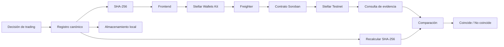

# Bitácora Verificable de Decisiones de Trading

MVP desarrollado para demostrar que una decisión de trading puede registrarse antes de conocer su resultado y verificarse posteriormente sin publicar la estrategia completa del trader.

La aplicación genera una representación canónica de la decisión, calcula su hash SHA-256 y registra únicamente esa huella en un contrato Soroban desplegado en Stellar Testnet.

## Estado del proyecto

El flujo principal está implementado y validado de extremo a extremo:

```text
decisión
→ registro canónico
→ SHA-256
→ wallet
→ contrato Soroban
→ Stellar Testnet
→ confirmación
→ consulta
→ verificación
```

El MVP no ejecuta operaciones reales ni se conecta a un broker.

## Arquitectura



### Componentes

- **Frontend:** Vite + JavaScript.
- **Hash:** SHA-256 mediante Web Crypto API.
- **Wallet:** Stellar Wallets Kit + Freighter.
- **Blockchain:** Stellar Testnet.
- **Contrato:** Soroban / Rust.
- **Datos completos:** permanecen fuera de blockchain.
- **Estado local:** `localStorage` para la demostración del historial.

## Contrato desplegado

Red:

```text
Stellar Testnet
```

Contract ID:

```text
CCPJNMXZCTLAZGYIZXKMDTXLU4PDIDO5AK67GQW23OPA6C3KPEB35QM3
```

WASM SHA-256:

```text
7382e5b2ac655eea9dd07725f934a29b8520ec79e368a253c4ffbbe5fbc8c56b
```

El contrato implementa:

```text
register_decision(owner, decision_hash)
get_decision(decision_hash)
exists(decision_hash)
```

Cada evidencia almacena solamente:

```text
owner
registered_at
```

El registro completo de la decisión no se publica en Stellar.

## Invariante principal

Una misma evidencia no puede sobrescribirse.

Si el `decision_hash` ya existe:

```text
register_decision(...) → false
```

La aplicación detecta este resultado durante la simulación y no solicita una nueva firma a la wallet.

## Evidencia validada en Testnet

Ejemplo registrado desde la dApp:

```text
Decision hash:
a0cae50a81719b475c59e6e0352d9054dc0a5fb47945d402ff8b688aecab42bf

Wallet:
GDSZGOY5AEIKKAZPPUU75JSTSP2YZJNSRM7B2UR6QZNLMZXFWG3VAH4U

Transaction hash:
74714f81c4619a09ef052e46b98888e8c43ad8bc458f8c093c0d082a6aaaa74d
```

También se validaron:

- consulta de evidencia sin nueva firma;
- reconstrucción del mismo hash a partir del mismo registro canónico;
- rechazo lógico de un registro duplicado;
- ausencia de solicitud de firma para el duplicado;
- detección de modificaciones mediante SHA-256;
- persistencia local del registro confirmado;
- manejo de una transacción expirada (`tx_too_late`).

El despliegue y una validación adicional realizada por CLI están registrados en:

```text
stellar/deployments/testnet.json
```

## Requisitos

Para ejecutar el frontend:

- Node.js
- npm
- navegador moderno
- Freighter configurado en Stellar Testnet

Para desarrollar o probar el contrato:

- Rust
- target `wasm32v1-none`
- Stellar CLI

## Ejecutar el frontend

Clonar el repositorio:

```bash
git clone https://github.com/arendonb76/ProyectoTrading.git
cd ProyectoTrading
```

Instalar dependencias:

```bash
cd frontend
npm install
```

Iniciar la aplicación:

```bash
npm run dev
```

La configuración actual de Vite escucha en:

```text
http://127.0.0.1:5173
```

El puerto puede cambiar si ya existe otro proceso utilizándolo.

## Compilar el frontend

```bash
cd frontend
npm run build
```

## Contrato Soroban

El workspace se encuentra en:

```text
stellar/
```

y el contrato en:

```text
stellar/contracts/trading-evidence/
```

Ejecutar los tests:

```bash
cd stellar
cargo test
```

Los tests cubren:

- registro y consulta de una evidencia;
- protección contra sobrescritura del mismo hash;
- consulta de un hash inexistente.

Construir el contrato:

```bash
cd stellar
stellar contract build
```

El artefacto WASM de release se genera dentro de:

```text
stellar/target/wasm32v1-none/release/
```

## Estructura principal

```text
ProyectoTrading/
├── frontend/
│   ├── index.html
│   ├── package.json
│   └── src/
├── stellar/
│   ├── contracts/
│   │   └── trading-evidence/
│   ├── deployments/
│   │   └── testnet.json
│   ├── Cargo.toml
│   └── Cargo.lock
├── docs/
│   ├── semana1/
│   ├── semana2/
│   ├── semana3/
│   └── semana5/
└── README.md
```

## Documentación del proyecto

La evolución del proyecto se encuentra en `docs/`:

- `docs/semana1/ProblemBrief.md`: problema y contexto inicial.
- `docs/semana2/ProductBlueprint.md`: propuesta de valor, alcance, flujo y arquitectura inicial.
- `docs/semana3/Documentacion.md`: primera prueba funcional del frontend y decisión técnica inicial.
- `docs/semana5/AlejandroRendonB.md`: arquitectura final, evolución a Soroban y validación completa del MVP.

La documentación de Semana 3 se conserva como registro histórico. Durante la implementación se identificó que la regla "un mismo hash no puede registrarse dos veces" requería estado persistente, por lo que la arquitectura final evolucionó desde una operación Stellar nativa hacia un contrato Soroban mínimo.

## Limitaciones

Este MVP no demuestra:

- rentabilidad de una decisión de trading;
- calidad del agente que originó la decisión;
- veracidad de los datos de mercado;
- ejecución real de una operación por un broker;
- preparación para producción o Mainnet;
- conservación indefinida del estado Soroban.

El contrato utiliza almacenamiento `persistent`, pero esta versión todavía no implementa una política de extensión o restauración de TTL. Una versión destinada a retención de largo plazo debe gestionar explícitamente ese ciclo de vida.

## Alcance

Blockchain se utiliza exclusivamente como capa externa de evidencia.

El MVP demuestra que un registro presentado posteriormente puede compararse con una huella que fue registrada previamente en Stellar, sin almacenar en blockchain la estrategia completa, los parámetros privados ni todo el journal del trader.

## Autor

**Alejandro Rendon Blandon**
GitHub: `arendonb76`
