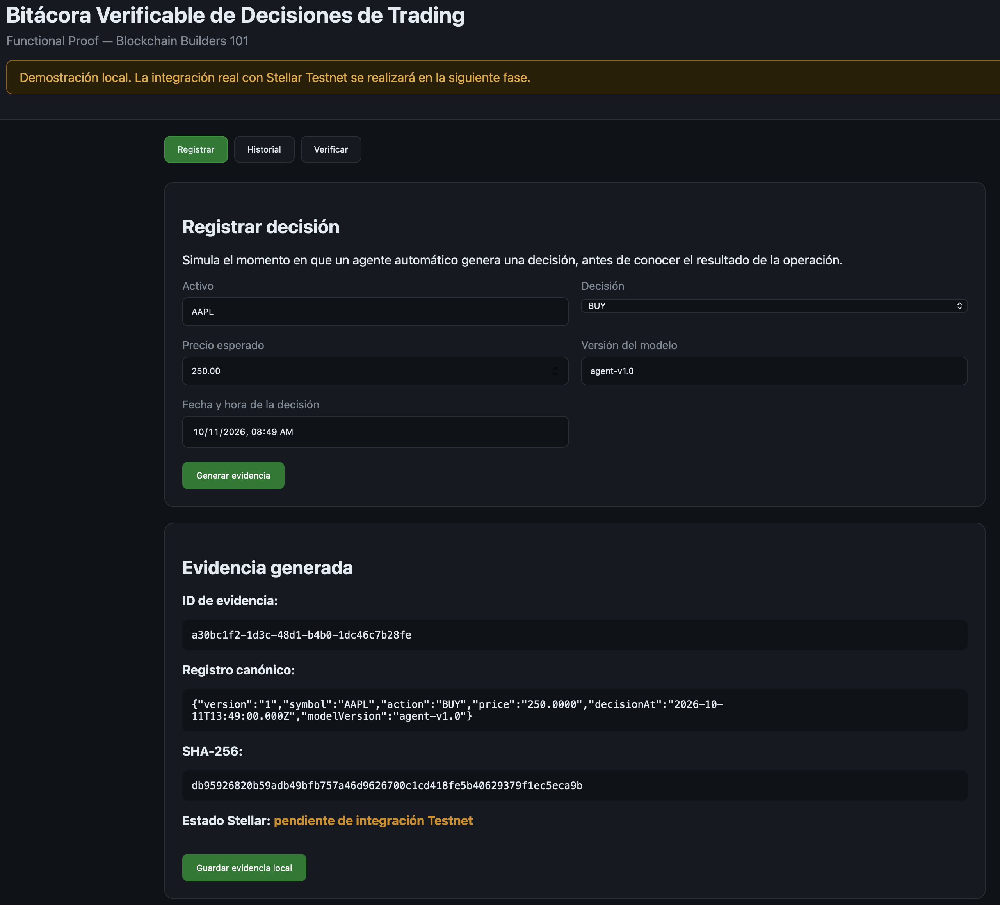
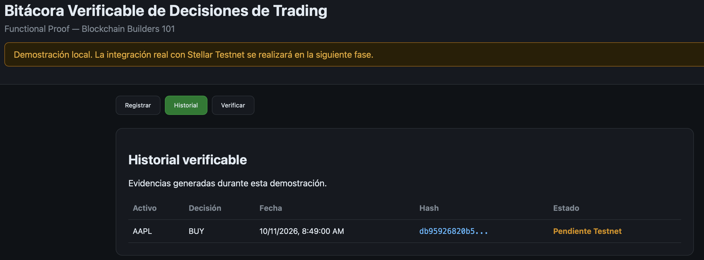
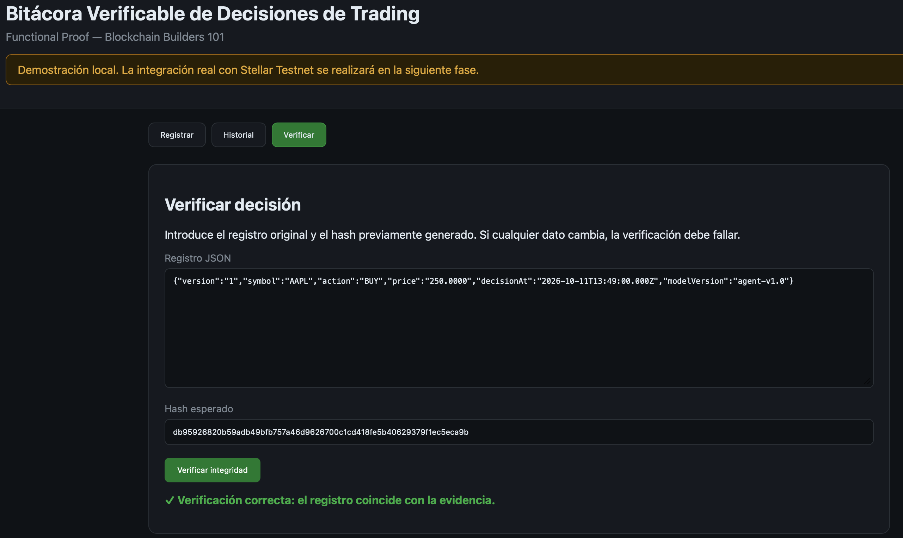

# Documentación - Semana 3

## Bitácora Verificable de Decisiones de Trading

## 1. Front construido

Durante esta semana se construyó la primera prueba funcional de la interfaz de la Bitácora Verificable de Decisiones de Trading. El objetivo del front no es todavía conectarse a un broker ni ejecutar operaciones reales, sino demostrar el flujo principal definido en el Product Blueprint: registrar una decisión, generar una evidencia y permitir verificar posteriormente que el registro no fue modificado.

La interfaz se divide en tres vistas principales: Registrar, Historial y Verificar.

### Registrar

La primera vista representa el momento en que un agente automático de trading ha tomado una decisión antes de conocerse el resultado de la operación.

El usuario puede ingresar el activo, el tipo de decisión (BUY, SELL o HOLD), el precio esperado, la versión del modelo que tomó la decisión y la fecha y hora.

Cuando el usuario selecciona "Generar evidencia", la aplicación transforma esos datos en una representación consistente del registro y calcula una huella SHA-256.

La aplicación muestra:

- un identificador único de evidencia;
- el registro utilizado para generar la huella;
- el hash SHA-256;
- el estado de integración con Stellar.

Durante esta fase el estado se muestra como "Pendiente de integración Testnet". Esto es intencional: esta entrega construye el front y documenta la decisión técnica, pero todavía no pretende simular como real una transacción que no ha sido enviada a Stellar.

### Historial

Una vez generada una evidencia, el usuario puede guardarla localmente.

La vista Historial muestra las decisiones que se han generado durante la demostración, indicando activo, acción, fecha, una versión abreviada del hash y su estado.

Para esta prueba funcional se utiliza el almacenamiento local del navegador. Este almacenamiento no pretende reemplazar la futura evidencia en Stellar; únicamente permite demostrar el recorrido completo de la interfaz durante esta etapa.

### Verificar

La tercera vista permite comprobar la integridad de una decisión.

El usuario introduce el registro de decisión y el hash que debería corresponderle. La aplicación vuelve a calcular SHA-256 sobre el contenido recibido.

Si el nuevo hash coincide exactamente con el original, la interfaz muestra "Verificación correcta".

Si cualquier campo del registro fue modificado, aunque sea mínimamente, el nuevo hash es diferente y la aplicación muestra "Verificación fallida".

Esta función permite demostrar desde el front la propiedad central del producto: un tercero puede detectar que el registro mostrado posteriormente ya no corresponde exactamente con la evidencia generada originalmente.

### Relación con el MVP

El front implementa el recorrido principal definido durante la Semana 2:

1. El agente toma una decisión.
2. La aplicación recibe el registro.
3. Se genera la huella criptográfica.
4. Se conserva la evidencia.
5. Posteriormente se presenta el registro original.
6. La aplicación vuelve a calcular la huella.
7. Se determina si coincide o no.

Todavía no se integra un broker ni un sistema real de trading. Tampoco se almacena información confidencial de una estrategia en blockchain.

El alcance sigue deliberadamente limitado a demostrar el mecanismo de registro y verificación.

### Capturas

## 2. Decisión técnica

Se eligió la **Opción B: utilizar una solución existente del ecosistema de Stellar**, en lugar de desarrollar un contrato propio durante este proyecto.

La solución utilizará Stellar Testnet y las capacidades nativas de las transacciones de Stellar, accedidas desde la aplicación mediante el SDK de JavaScript.

Para cada decisión de trading, la aplicación calculará localmente un hash SHA-256 de 32 bytes. En la fase de integración este sello se incluirá en una transacción de Stellar y se conservará el hash de la transacción como referencia verificable.

Esta decisión sigue el diseño establecido en el Product Blueprint: la información completa de la decisión permanece fuera de la red y únicamente se registra la huella necesaria para verificar su integridad.

No se eligió un contrato Soroban porque el MVP no necesita ejecutar reglas propias con estado, pagos condicionados, autorización compleja ni lógica que deba vivir dentro de la blockchain. El producto solo necesita publicar una evidencia y consultarla posteriormente.

Utilizar un contrato introduciría código Rust, despliegue, almacenamiento, TTL, mantenimiento y costos adicionales sin resolver una necesidad que no pueda cubrirse mediante las capacidades nativas de Stellar.

Si posteriormente el producto requiriera reglas de autorización, múltiples actores escribiendo sobre un registro común o lógica programable sobre las evidencias, se volvería a evaluar la necesidad de un contrato Soroban.

## 3. Participación del equipo

El proyecto se desarrolla individualmente debido a que no se conformó un equipo durante la primera semana.

**Integrante:** Alejandro Rendon Blandon  
**Usuario de GitHub:** arendonb76

Responsabilidades durante esta entrega:

- construcción del front;
- implementación de la generación y verificación SHA-256;
- documentación de la arquitectura;
- decisión técnica sobre Stellar;
- mantenimiento del repositorio y commits del entregable.

## 4. Bloqueos y siguiente paso

No existen bloqueos que impidan demostrar el flujo principal del MVP.

La integración real con Stellar Testnet queda pendiente para la siguiente fase. Actualmente el front genera y verifica correctamente la huella criptográfica, pero la evidencia se conserva localmente para efectos de esta prueba funcional.

El siguiente paso será sustituir el estado "Pendiente de integración Testnet" por una transacción real enviada mediante Stellar JavaScript SDK, registrar el hash de la evidencia y conservar el hash de la transacción como referencia verificable.

También se deberá definir y probar la cuenta Testnet que firmará las transacciones y confirmar las operaciones mediante las herramientas de exploración de Stellar.