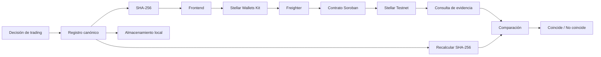

# Documentación - Semana 5

## Bitácora Verificable de Decisiones de Trading

**Integrante:** Alejandro Rendon Blandon  
**GitHub:** arendonb76

## 1. Estado final del MVP

El MVP implementa un flujo verificable para demostrar que una decisión de trading existía antes de conocerse su resultado y que su contenido no fue modificado posteriormente.

El alcance permanece deliberadamente limitado. El sistema no ejecuta operaciones reales, no se conecta a un broker y no publica la estrategia completa del trader en blockchain.

El flujo final es:

1. El usuario introduce una decisión de trading.
2. La aplicación construye una representación canónica del registro.
3. Se calcula su hash SHA-256.
4. El usuario conecta una wallet Stellar.
5. La wallet autoriza el registro.
6. Un contrato Soroban registra únicamente el hash en Stellar Testnet.
7. La aplicación conserva localmente el registro completo y la referencia de la transacción.
8. Posteriormente puede recalcularse el hash y consultar la evidencia en Stellar.
9. Si el contenido cambia, el hash deja de coincidir.

## 2. Evolución de la decisión técnica

Durante una fase anterior se había planteado utilizar únicamente operaciones nativas de Stellar y no desarrollar un contrato.

La implementación permitió identificar una regla adicional necesaria para el MVP:

> una evidencia ya registrada no debe poder sobrescribirse ni registrarse nuevamente como una evidencia nueva.

Esta regla requiere conocer si un hash ya existe y conservar estado entre transacciones. Por esa razón se revisó la decisión inicial y se implementó un contrato Soroban mínimo.

El cambio no modifica la propuesta de valor: el registro completo sigue permaneciendo fuera de la blockchain y en Stellar únicamente se conserva la evidencia mínima necesaria.

## 3. Arquitectura final



### Componentes
- Frontend: interfaz web construida con Vite y JavaScript.
- SHA-256: genera la huella criptográfica de la decisión.
- Stellar Wallets Kit: conecta la aplicación con la wallet.
- Freighter: permite al usuario autorizar la transacción.
- Soroban: implementa la regla de registro único.
- Stellar Testnet: mantiene la evidencia verificable.
- localStorage: conserva localmente los datos completos necesarios para la demostración.

## 4. Registro canónico
Antes de calcular el hash, la aplicación convierte la decisión a una representación determinista con los siguientes campos:

```json
{
  "version": "1",
  "symbol": "AAPL",
  "action": "BUY",
  "price": "250.0000",
  "decisionAt": "2026-10-17T17:33:00.000Z",
  "modelVersion": "agent-v1.0"
}
```

Para este ejemplo se obtuvo:

```text
a0cae50a81719b475c59e6e0352d9054dc0a5fb47945d402ff8b688aecab42bf
```

El mismo registro produce siempre el mismo hash. Una modificación en cualquiera de los campos produce una huella diferente.

## 5. Contrato Soroban
El contrato desplegado en Stellar Testnet es:

```text
CCPJNMXZCTLAZGYIZXKMDTXLU4PDIDO5AK67GQW23OPA6C3KPEB35QM3
```

Implementa tres operaciones:

```text
register_decision(owner, decision_hash)
get_decision(decision_hash)
exists(decision_hash)
```

Cada evidencia conserva únicamente:

```text
owner
registered_at
```

El registro completo de trading no se almacena on-chain.

### Invariante principal
Si un `decision_hash` ya existe:

```text
register_decision(...) → false
```

y la evidencia existente no se modifica.

## 6. Validación en Stellar Testnet

### Caso 1 - Registro exitoso
Se registró desde la dApp la evidencia:

```text
Hash:
a0cae50a81719b475c59e6e0352d9054dc0a5fb47945d402ff8b688aecab42bf

Wallet:
GDSZGOY5AEIKKAZPPUU75JSTSP2YZJNSRM7B2UR6QZNLMZXFWG3VAH4U

Transaction hash:
74714f81c4619a09ef052e46b98888e8c43ad8bc458f8c093c0d082a6aaaa74d
```

Resultado:

```text
✓ Evidencia registrada en Stellar Testnet
```

Después de la confirmación, la evidencia quedó almacenada también en el historial local con estado confirmado.

### Caso 2 - Consulta independiente
La aplicación puede consultar el contrato utilizando únicamente el hash.
Las consultas exists y get_decision son de lectura y no requieren una nueva firma de la wallet.
Esto permite comprobar independientemente que la evidencia existe en Stellar.

### Caso 3 - Registro duplicado
Se reconstruyó exactamente el mismo registro canónico y se obtuvo nuevamente:

```text
a0cae50a81719b475c59e6e0352d9054dc0a5fb47945d402ff8b688aecab42bf
```

Al intentar registrarlo nuevamente, la aplicación mostró:

```text
Esta evidencia ya existe en Stellar.

No se solicitó una nueva firma.
```

Freighter no se abrió.
Esto demuestra que la aplicación detecta mediante la simulación del contrato que la evidencia ya existe antes de pedir al usuario una firma innecesaria.

### Caso 4 - Transacción expirada
Durante una prueba se dejó abierta la solicitud de firma durante demasiado tiempo.
La red rechazó posteriormente la transacción con:

```text
tx_too_late
```

La evidencia consultada después de ese intento no existía en el contrato.
Para evitar que una pausa normal del usuario provoque este problema, el cliente se configuró con un tiempo de expiración mayor.
Esta prueba también permitió comprobar que la interfaz no debe considerar una evidencia confirmada hasta recibir confirmación real de Stellar.

## 7. Criterios técnicos validados

| Criterio | Resultado |
|---|---|
| Generar un registro canónico | PASS |
| Calcular SHA-256 | PASS |
| Conectar wallet Stellar | PASS |
| Autorizar mediante Freighter | PASS |
| Registrar evidencia en Soroban Testnet | PASS |
| Obtener transaction hash | PASS |
| Consultar una evidencia registrada | PASS |
| Consultar sin nueva firma | PASS |
| Detectar alteración del registro | PASS |
| Impedir sobrescritura del mismo hash | PASS |
| Evitar firma innecesaria para duplicados | PASS |
| Mantener el registro completo fuera de blockchain | PASS |
| Guardar evidencia confirmada en historial local | PASS |

## 8. Qué demuestra el MVP
El MVP demuestra técnicamente que:
- una decisión puede transformarse en una representación determinista;
- puede generarse una huella criptográfica de esa decisión;
- esa huella puede registrarse en una red externa antes del resultado;
- mientras la entrada persistente permanezca disponible en Soroban, Stellar permite comprobar que ese hash fue registrado;
- la aplicación puede consultar posteriormente esa evidencia;
- una modificación del registro original produce otra huella;
- un hash ya registrado no puede sobrescribirse mediante el contrato.
Por tanto, un trader puede demostrar que un registro determinado coincide con una evidencia que ya existía en Stellar, sin publicar la estrategia completa ni el journal en blockchain.

## 9. Qué no demuestra
El MVP no demuestra:
- que la decisión de trading haya sido rentable;
- que el agente que originó la decisión sea correcto;
- que los datos de mercado utilizados fueran verdaderos;
- que una operación haya sido ejecutada por un broker;
- que el sistema esté preparado para producción o Mainnet;
- que la evidencia permanezca disponible indefinidamente: el MVP utiliza almacenamiento `persistent` de Soroban, pero todavía no implementa una política de extensión o restauración de TTL.
Blockchain se utiliza para proporcionar una evidencia externa y verificable del registro. La retención de largo plazo del estado del contrato requiere gestionar explícitamente el TTL de Soroban.

## 10. Conclusión
La prueba técnica principal quedó completada de extremo a extremo:

```text
decisión
→ canonicalización
→ SHA-256
→ autorización de wallet
→ contrato Soroban
→ Stellar Testnet
→ confirmación
→ consulta
→ verificación
```

El resultado valida la factibilidad técnica del mecanismo central de la Bitácora Verificable de Decisiones de Trading.
El siguiente paso del proyecto ya no es demostrar que el mecanismo funciona técnicamente, sino validar si usuarios reales consideran útil esta prueba y si la utilizarían como parte de su proceso de auditoría o presentación de resultados.